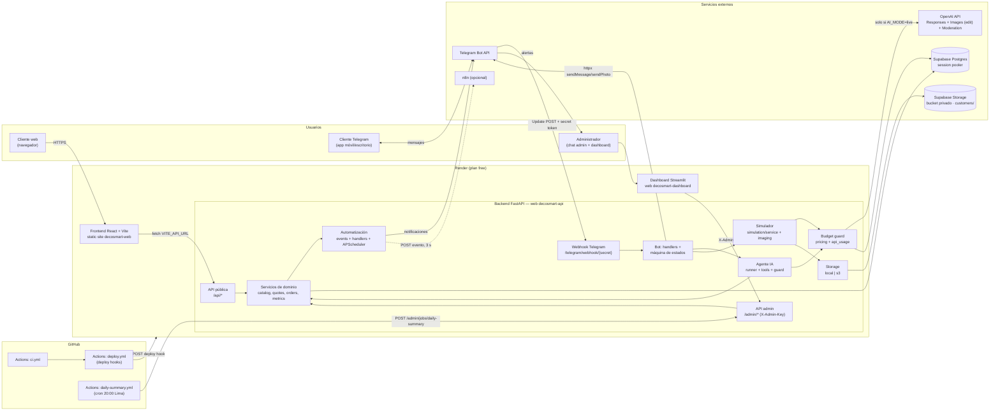
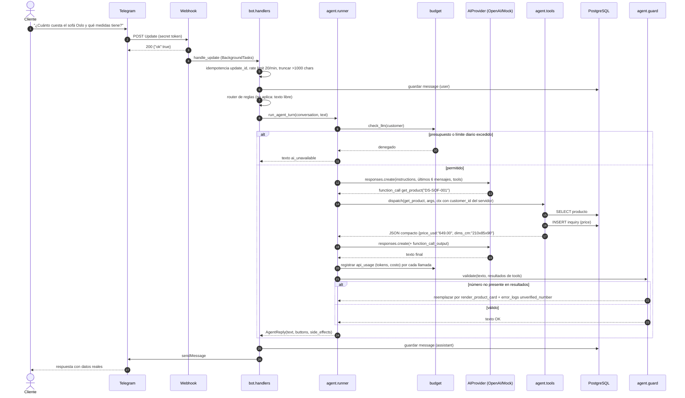
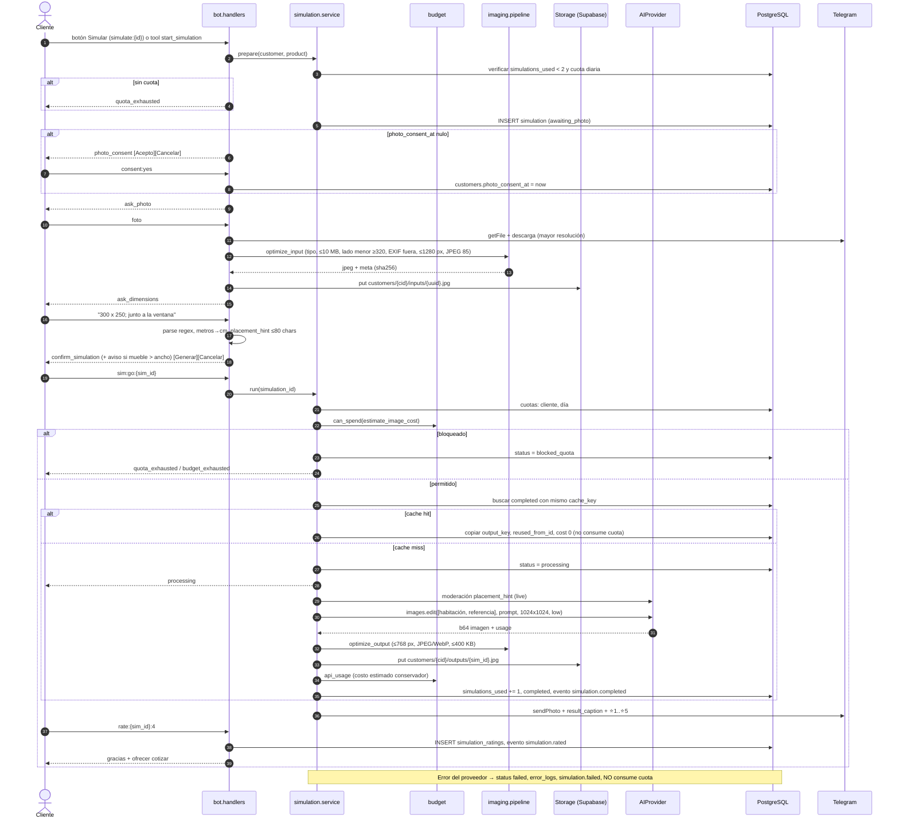
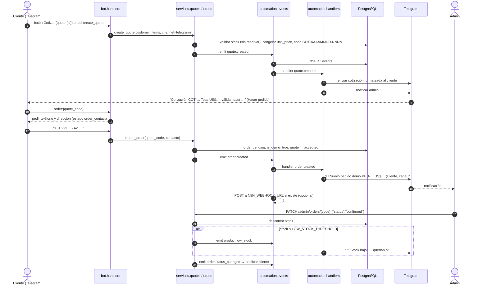
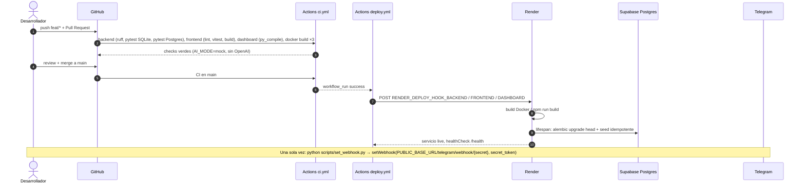
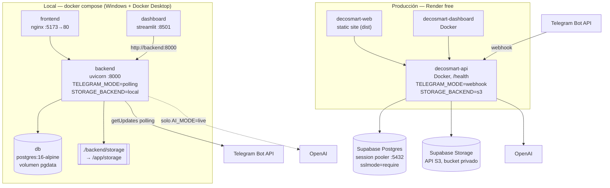

# 02 — Arquitectura del sistema

> Entregables 6 y 7. Detalle de módulos en [`CODEX_HANDOFF.md`](CODEX_HANDOFF.md) §2 y §5; endpoints en [04](04-api-contratos.md); tablas en [03](03-modelo-datos.md).

## 1. Diagrama de componentes

### Responsabilidad de cada componente

| Componente | Código | Responsabilidad |
|---|---|---|
| Frontend | `frontend/src/` | Catálogo, detalle, carrito (zustand + localStorage), cotización, checkout demo, deep link a Telegram. Nunca hardcodea precios. |
| API pública | `app/api/public.py` | Catálogo, cotizaciones, pedidos, config pública. CORS restringido + rate limit. |
| API admin | `app/api/admin.py` | Métricas, uso de API, eventos, errores, simulaciones, PATCH de estados/stock, jobs. |
| Webhook Telegram | `app/api/telegram.py` | Valida secreto, responde 200 inmediato y procesa en `BackgroundTasks`. |
| Bot | `app/bot/` | Máquina de estados (`conversations.state`), router de reglas sin LLM, teclados, textos fijos, cliente `httpx`. |
| Agente IA | `app/agent/` | Bucle de *function calling* con la Responses API, herramientas sobre servicios, validador anti-alucinación. |
| Simulador | `app/simulation/`, `app/imaging/` | Cuotas, caché, prompt, `images.edit`, optimización de entrada/salida, rating. |
| Automatización | `app/automation/` | `emit()` de eventos, handlers de notificación, scheduler (resumen, expiración, limpieza), reenvío a n8n. |
| Budget guard | `app/services/budget.py`, `app/core/pricing.py` | Estima costo, bloquea si se excede `BUDGET_USD_LIMIT`, registra `api_usage`. |
| Storage | `app/storage/` | Protocolo `put/get/url/delete` con backend local o S3 (Supabase Storage). |
| Proveedor IA | `app/ai/` | `AIProvider` con `OpenAIProvider` y `MockProvider` (`AI_MODE`). |
| Dashboard | `dashboard/` | KPIs vía `/admin/*` con `st.cache_data(ttl=30)`. |

## 2. Diagramas de secuencia

### 2.1 Consulta por chat con *tool calling* y guardia

### 2.2 Flujo completo de simulación

### 2.3 Cotización, pedido demo y notificación al admin

### 2.4 Flujo de despliegue

## 3. Despliegue: local vs producción

| Aspecto | Local | Producción |
|---|---|---|
| Telegram | `polling` (hilo daemon en `lifespan`) | `webhook` con `secret_token` |
| BD | Supabase (por defecto, `DATABASE_URL` de `.env`) o contenedor `postgres:16-alpine` opcional (`--profile localdb`) | Supabase Postgres (free, persistente; session pooler) |
| Imágenes | Disco local `./backend/storage` servido en `/media/*` | Supabase Storage: bucket privado, solo `customers/` con URL prefirmada; catálogo servido por el backend en `/static/products` |
| IA | `AI_MODE=mock` por defecto | `AI_MODE=live` solo en sesiones controladas |
| Scheduler | APScheduler | APScheduler + respaldo `daily-summary.yml` |
| Frontend | nginx en contenedor | Static site de Render con rewrite `/* → /index.html` |

## 4. Decisiones clave de arquitectura

Resumen; el registro formal está en [`DECISIONES.md`](DECISIONES.md).

| Decisión | Justificación |
|---|---|
| **Bot dentro del backend** | Un solo servicio desplegable (importante en Render free) y acceso directo a servicios y BD sin una segunda API interna. El webhook es solo un endpoint más de FastAPI. |
| **Cliente Telegram propio con `httpx`** | Evita el bucle de eventos de `python-telegram-bot`; el mismo `handle_update(update: dict)` sirve para webhook y polling; tests con `respx` sin red. |
| **SQLAlchemy 2.0 síncrono** | Endpoints sync en threadpool bastan para la carga de un prototipo; tests más simples (SQLite) y menos errores de concurrencia. |
| **Modo mock (`AI_MODE=mock`)** | `MockProvider` llama a las mismas herramientas reales con reglas por palabras clave: desarrollo, CI y contingencia de demo con costo 0. |
| **Sin frameworks de agentes** | El bucle de *function calling* cabe en ~80 líneas, es auditable y permite inyectar el `customer_id` desde el servidor y aplicar la guardia y el presupuesto en un único punto. |
| **Router de reglas antes del LLM** | Saludos, menú, botones y comandos no gastan tokens. |
| **Guardias en el servidor** | Anti-alucinación (`guard.py`) y presupuesto (`budget.py`) no dependen del comportamiento del modelo. |
| **Procesamiento en `BackgroundTasks`** | El webhook responde 200 de inmediato; la imagen (hasta ~60 s) se genera fuera del ciclo de respuesta, evitando reintentos de Telegram. |
| **Storage desacoplado** | El protocolo `Storage` permite disco local en desarrollo y Supabase Storage (API S3) en producción sin cambiar el código de negocio. |
