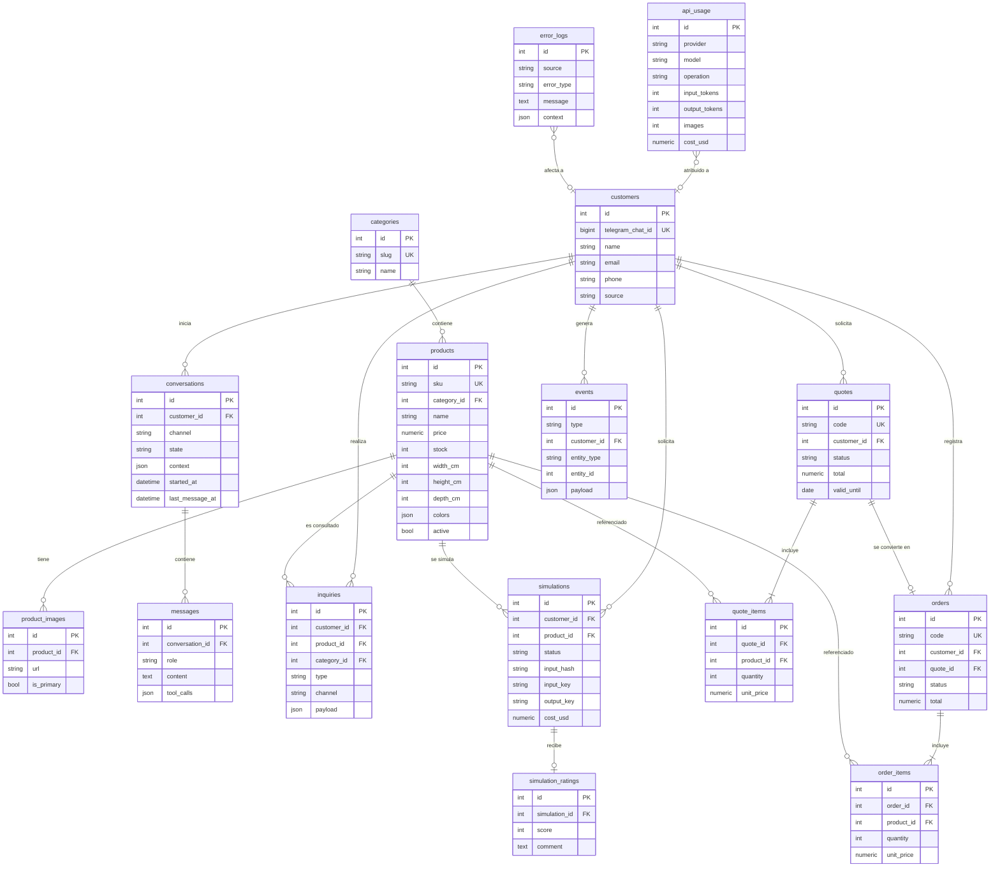

# 03 — Modelo de datos (ERD y diseño de tablas)

> Entregables 8 y 9. Motor: PostgreSQL 16 (prod: Neon; local: contenedor `postgres:16-alpine`).
> ORM: SQLAlchemy 2.0 (estilo `Mapped[...]`), migraciones con Alembic. Tests: SQLite en memoria con los mismos modelos (evitar tipos exclusivos de Postgres salvo `JSON`, que SQLAlchemy mapea en ambos).

## Conceptos que NO deben confundirse

| Concepto | Tabla | Qué es | Cuándo se crea |
|---|---|---|---|
| **Conversación** | `conversations` | Sesión de chat de un cliente en Telegram | Primer mensaje del día del cliente (o si la anterior lleva >6 h inactiva) |
| **Consulta** | `inquiries` | Pregunta concreta sobre un producto o categoría (precio, medidas, stock, recomendación) | Cada vez que el agente ejecuta una herramienta de catálogo con resultado |
| **Cotización** | `quotes` | Documento con productos, cantidades, precios congelados y validez | El cliente la pide (web o Telegram) |
| **Pedido demo** | `orders` | Intención de compra registrada. **No es una venta**: no hay pago | El cliente confirma una cotización o hace checkout demo en la web |
| **Venta concretada** | `orders.status = 'completed'` | Solo cuando un admin marca el pedido como entregado/pagado fuera del sistema | Manual, desde la API admin |

## ERD

## Diseño de tablas

Convenciones: todas las tablas tienen `id` (PK entera autoincremental), `created_at` (timestamptz, default now) y, cuando son mutables, `updated_at`. Dinero en `NUMERIC(10,2)` (USD, mostrar como "US$"). Estados como `VARCHAR` validados por `Enum` de Python (no enums nativos de Postgres, para migraciones simples).

### categories
| Columna | Tipo | Restricciones |
|---|---|---|
| slug | varchar(50) | UNIQUE, NOT NULL (`sofas`, `mesas`, `sillas`, `camas`, `almacenamiento`, `escritorios`) |
| name | varchar(100) | NOT NULL |
| description | text | NULL |

### products
| Columna | Tipo | Restricciones |
|---|---|---|
| sku | varchar(30) | UNIQUE, NOT NULL (ej. `DS-SOF-001`) |
| category_id | int | FK categories.id, NOT NULL |
| name | varchar(150) | NOT NULL |
| slug | varchar(160) | UNIQUE, NOT NULL |
| description | text | NOT NULL |
| price | numeric(10,2) | NOT NULL, CHECK > 0 |
| stock | int | NOT NULL, CHECK >= 0 |
| width_cm / height_cm / depth_cm | int | NOT NULL, CHECK > 0 |
| colors | json | lista de strings, NOT NULL |
| material | varchar(100) | NULL |
| style | varchar(50) | NULL (`moderno`, `nordico`, `industrial`, `clasico`) |
| room_types | json | lista: `sala`, `dormitorio`, `comedor`, `oficina` |
| reference_image_key | varchar(255) | clave en storage de la imagen limpia del producto (fondo neutro) usada como referencia para la simulación |
| active | bool | default true |

Índices: `(category_id)`, `(active, price)`.

### product_images
`product_id` FK (ON DELETE CASCADE), `url` varchar(500), `alt` varchar(200), `is_primary` bool, `sort_order` int.

### customers
| Columna | Tipo | Notas |
|---|---|---|
| telegram_chat_id | bigint | UNIQUE, NULL (clientes web no tienen) |
| telegram_username | varchar(64) | NULL |
| name | varchar(150) | NULL |
| email | varchar(200) | NULL |
| phone | varchar(30) | NULL |
| source | varchar(20) | `telegram` \| `web` |
| photo_consent_at | timestamptz | NULL; se fija cuando acepta el aviso de privacidad de fotos |
| simulations_used | int | default 0 (contador para el límite `MAX_SIMULATIONS_PER_CUSTOMER`) |

Clientes web se deduplican por email.

### conversations
`customer_id` FK; `channel` (`telegram`); `state` varchar(40) — estado de la máquina del bot (ver handoff §Bot); `context` json — datos temporales del flujo (producto seleccionado, medidas, `pending_photo_key`); `started_at`, `last_message_at`; `message_count` int.

### messages
`conversation_id` FK (CASCADE); `role` (`user` \| `assistant` \| `tool` \| `system_event`); `content` text; `tool_calls` json NULL; `telegram_message_id` bigint NULL. Solo se envían al LLM los últimos `AGENT_HISTORY_TURNS` mensajes.

### inquiries
`customer_id` FK NULL; `product_id` FK NULL; `category_id` FK NULL; `type` (`product_info` \| `price` \| `dimensions` \| `stock` \| `recommendation` \| `catalog`); `channel` (`telegram` \| `web`); `payload` json (filtros usados, p. ej. `{"budget": 500}`).

### simulations
| Columna | Tipo | Notas |
|---|---|---|
| customer_id | int FK | NOT NULL |
| product_id | int FK | NOT NULL |
| status | varchar(20) | `awaiting_photo` → `awaiting_dimensions` → `awaiting_confirmation` → `processing` → `completed` \| `failed` \| `cancelled` \| `blocked_quota` |
| room_width_cm / room_height_cm / room_depth_cm | int | depth NULL |
| input_key | varchar(255) | foto optimizada (≤1280 px) en storage |
| input_hash | varchar(64) | sha256 de la foto optimizada |
| cache_key | varchar(64) | sha256(input_hash + product_id + medidas + modelo + calidad + tamaño) — para reutilizar resultados |
| output_key | varchar(255) | resultado optimizado (≤768 px) en storage |
| output_full_key | varchar(255) | resultado tal como lo devolvió el modelo (opcional) |
| prompt | text | prompt final enviado |
| model / size / quality | varchar | parámetros usados |
| input_bytes / output_bytes | int | pesos tras compresión |
| cost_usd | numeric(10,4) | costo estimado |
| reused_from_id | int FK simulations.id | NULL; si se reutilizó |
| error_message | text | NULL |
| completed_at | timestamptz | NULL |

### simulation_ratings
`simulation_id` FK UNIQUE; `score` int CHECK 1..5; `comment` text NULL.

### quotes
`code` varchar(20) UNIQUE (`COT-20261118-0001`); `customer_id` FK; `channel`; `status` (`draft` \| `sent` \| `accepted` \| `rejected` \| `expired`); `subtotal`, `total` numeric(10,2); `valid_until` date (hoy + `QUOTE_VALIDITY_DAYS`); `notes` text; `sent_at` timestamptz NULL.

### quote_items
`quote_id` FK CASCADE; `product_id` FK; `quantity` int CHECK > 0; `unit_price` numeric(10,2) **congelado al crear**; `line_total` numeric(10,2).

### orders
`code` UNIQUE (`PED-20261118-0001`); `customer_id` FK; `quote_id` FK NULL; `channel`; `status` (`pending` → `confirmed` → `completed` \| `cancelled`); `total`; `contact_name`, `contact_email`, `contact_phone`, `delivery_address` (texto libre); `is_demo` bool default true.

### order_items
Igual que `quote_items` con `order_id`.

Crear un pedido **no descuenta stock real** en el MVP salvo que se pase a `confirmed` (entonces se descuenta y se evalúa la alerta de stock bajo).

### events
Bitácora de automatización e historial del dashboard. `type` (ver catálogo en handoff §Automatización), `customer_id` NULL, `entity_type` (`quote`, `order`, `simulation`, `product`, `inquiry`, `system`), `entity_id` NULL, `payload` json, `processed` bool, `notified` bool.

### api_usage
`provider` (`openai`), `model`, `operation` (`chat` \| `image_edit` \| `moderation`), `input_tokens`, `cached_input_tokens`, `output_tokens`, `image_input_tokens`, `images` int, `cost_usd` numeric(10,6), `mode` (`mock` \| `live`), `customer_id` NULL, `simulation_id` NULL, `latency_ms` int, `success` bool.

### error_logs
`source` (`bot`, `agent`, `simulation`, `api`, `automation`, `storage`), `error_type`, `message`, `context` json (sin datos personales), `customer_id` NULL.

## Seed inicial (6 productos)

| SKU | Nombre | Categoría | Precio US$ | Stock | An×Al×Pr (cm) | Colores |
|---|---|---|---|---|---|---|
| DS-SOF-001 | Sofá Oslo 3 plazas | sofas | 649.00 | 8 | 210×85×90 | gris, beige, azul petróleo |
| DS-MES-001 | Mesa de centro Nórdica | mesas | 149.00 | 15 | 100×45×60 | roble natural, nogal |
| DS-SIL-001 | Silla Arco Comedor (set x2) | sillas | 119.00 | 20 | 47×82×55 | blanco, negro, gris |
| DS-CAM-001 | Cama Queen Lumbre | camas | 529.00 | 4 | 165×110×215 | nogal, blanco |
| DS-ALM-001 | Librero Modular Cubo | almacenamiento | 189.00 | 3 | 120×180×35 | blanco, roble |
| DS-ESC-001 | Escritorio Home Office Kappa | escritorios | 229.00 | 10 | 120×75×60 | negro/roble, blanco |

Stock 3–4 en dos productos permite demostrar la alerta de stock bajo (`LOW_STOCK_THRESHOLD=5`).
