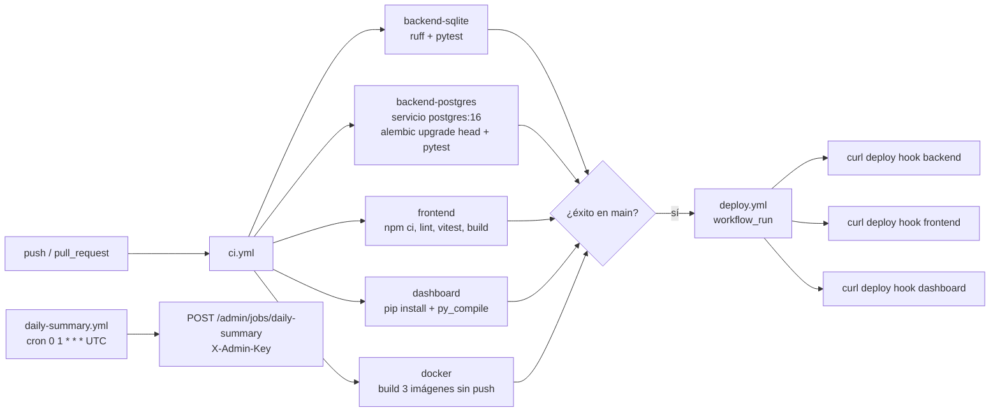
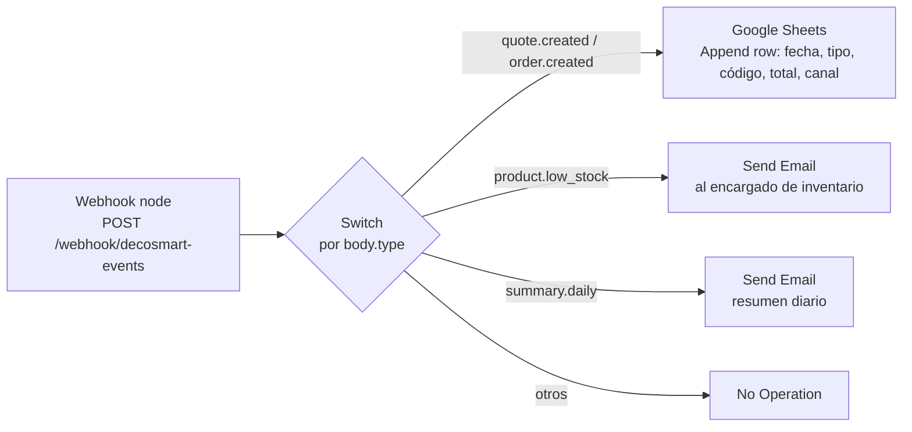

# 10 — DevOps: Docker, CI/CD y despliegue

> Entregable 17. Especificación base en [`CODEX_HANDOFF.md`](CODEX_HANDOFF.md) §4 (variables) y §6 (Docker, CI/CD, Render).
> Estado: **Implementable (MVP)**, salvo n8n (**Experimental / opcional**).

## 1. Estrategia de contenedores

| Imagen | Base | Construcción | Ejecución | Notas |
|---|---|---|---|---|
| `backend/Dockerfile` | `python:3.11-slim` | `pip install --no-cache-dir -r requirements.txt`; copia `app/`, `alembic/`, `seed/`, `scripts/`; crea usuario no root | `uvicorn app.main:app --host 0.0.0.0 --port ${PORT:-8000}` | Migraciones (`AUTO_MIGRATE`) y seed (`AUTO_SEED`) se ejecutan en `lifespan`. Render inyecta `PORT`. |
| `frontend/Dockerfile` | Multi-stage: `node:20-alpine` (build) → `nginx:alpine` | `npm ci && npm run build` con `ARG VITE_API_URL`, `ARG VITE_TELEGRAM_BOT_URL` | nginx sirve `dist/` con `try_files $uri /index.html` (`nginx.conf`) | Variables `VITE_*` se fijan en **build time**: cambiar la URL de la API exige reconstruir. En Render el frontend se publica como static site (no usa este Dockerfile; se usa en local y en CI). |
| `dashboard/Dockerfile` | `python:3.11-slim` | `pip install -r requirements.txt` | `streamlit run app.py --server.port ${PORT:-8501} --server.address 0.0.0.0 --server.headless true` | Usuario no root. |

Buenas prácticas: `.dockerignore` en cada carpeta (excluir `node_modules`, `.venv`, `__pycache__`, `storage/`, `.env`, `tests/` en la imagen final si no se necesitan), versiones fijadas, capas de dependencias antes del código para aprovechar caché.

### docker-compose.yml (local)

| Servicio | Imagen/Build | Puertos | Dependencias | Volúmenes | Variables |
|---|---|---|---|---|---|
| `db` (opcional, perfil `localdb`) | `postgres:16-alpine` | `5432:5432` | — | `pgdata:/var/lib/postgresql/data` | `POSTGRES_USER/PASSWORD/DB=decosmart`; healthcheck `pg_isready` |
| `backend` | `./backend` | `8000:8000` | — (usa `DATABASE_URL` de `.env`: Supabase por defecto) | `./backend/storage:/app/storage` | `env_file: .env` |
| `frontend` | `./frontend` (args `VITE_API_URL`, `VITE_TELEGRAM_BOT_URL`) | `5173:80` | `backend` | — | — |
| `dashboard` | `./dashboard` | `8501:8501` | `backend` | — | `DASHBOARD_API_URL=http://backend:8000`, `DASHBOARD_ADMIN_KEY`, `DASHBOARD_PASSWORD` |

Por defecto el backend se conecta a Supabase con el `DATABASE_URL` de `.env`; el servicio `db` solo se levanta con `docker compose --profile localdb up` (entonces `DATABASE_URL=postgresql+psycopg://decosmart:decosmart@db:5432/decosmart`).

Volúmenes: `pgdata` (named volume del perfil `localdb`, persiste la BD local entre reinicios; `docker compose down -v` la borra) y bind mount `./backend/storage` (fotos y resultados locales; está en `.gitignore`).

## 2. Runbook local (Windows + Docker Desktop)

Requisitos: Windows 10/11, Docker Desktop con WSL 2, Git, (opcional) Python 3.11 y Node 20 para correr tests fuera de Docker.

1. Clonar:
   ```powershell
   git clone https://github.com/<org>/decosmart-ai.git
   cd decosmart-ai
   ```
2. Crear `.env` desde el ejemplo:
   ```powershell
   Copy-Item .env.example .env
   ```
   Completar `DATABASE_URL` con la cadena del session pooler de Supabase (§5; se recomienda un proyecto Supabase de desarrollo distinto al de producción) **o** usar Postgres local (`DATABASE_URL=postgresql+psycopg://decosmart:decosmart@db:5432/decosmart`). Dejar `AI_MODE=mock`, `TELEGRAM_MODE=polling`, `STORAGE_BACKEND=local`. Para probar el bot, poner `TELEGRAM_BOT_TOKEN` de un **bot de desarrollo** (distinto al de producción: un token no puede tener polling y webhook a la vez) y `ADMIN_TELEGRAM_CHAT_ID` (§6.3).
3. Levantar:
   ```powershell
   docker compose up --build                      # BD en Supabase (DATABASE_URL de .env)
   docker compose --profile localdb up --build    # alternativa: Postgres local en contenedor
   ```
4. Verificar:
   - API: http://localhost:8000/health → `{"status":"ok","db":"ok",...}` y http://localhost:8000/docs
   - Tienda: http://localhost:5173
   - Dashboard: http://localhost:8501
   - Bot: escribir `/start` al bot de desarrollo.
5. Logs: `docker compose logs -f backend`.
6. Tests sin Docker:
   ```powershell
   cd backend; python -m venv .venv; .\.venv\Scripts\Activate.ps1; pip install -r requirements-dev.txt; pytest
   cd ..\frontend; npm ci; npm run lint; npm test; npm run build
   ```
7. Probar IA real (solo sesiones controladas, doc 07 §7): `AI_MODE=live` y `OPENAI_API_KEY` en `.env`, luego `docker compose up -d --force-recreate backend`.
8. Reiniciar la BD local desde cero (perfil `localdb`): `docker compose --profile localdb down -v; docker compose --profile localdb up --build`. Con Supabase no se borra la base: usar el *SQL Editor* o un proyecto de desarrollo aparte.

Problemas frecuentes: puerto ocupado (cambiar el mapeo en compose); finales de línea CRLF en scripts `.sh` (configurar `git config core.autocrlf input` o `.gitattributes`); Docker Desktop sin WSL 2 activo.

## 3. CI/CD con GitHub Actions



| Workflow | Disparador | Qué hace | Variables/secretos |
|---|---|---|---|
| `ci.yml` | `push` y `pull_request` | Jobs en paralelo: **backend** (ruff check, pytest con `AI_MODE=mock`, `DATABASE_URL=sqlite:///./test.db`), **backend-postgres** (servicio `postgres:16`, `alembic upgrade head`, pytest), **frontend** (npm ci, lint, vitest, build), **dashboard** (pip install, `python -m py_compile`), **docker** (build de las 3 imágenes, sin push). Caché de pip y npm. Meta: < 10 min. | Ninguno secreto (no usa OpenAI ni Telegram reales) |
| `deploy.yml` | `workflow_run` de CI con `conclusion == success` en `main` | `curl -fsS -X POST "$RENDER_DEPLOY_HOOK_BACKEND"` (y frontend, dashboard). El webhook de Telegram **no** se configura aquí. | `RENDER_DEPLOY_HOOK_BACKEND`, `RENDER_DEPLOY_HOOK_FRONTEND`, `RENDER_DEPLOY_HOOK_DASHBOARD` |
| `daily-summary.yml` | `schedule: cron "0 1 * * *"` (01:00 UTC = 20:00 Lima) + `workflow_dispatch` | `curl -fsS -X POST "$BACKEND_URL/admin/jobs/daily-summary" -H "X-Admin-Key: $ADMIN_API_KEY"` con reintento (el servicio puede estar dormido). | `BACKEND_URL`, `ADMIN_API_KEY` |

**Secretos de GitHub** (*Settings → Secrets and variables → Actions*): `RENDER_DEPLOY_HOOK_BACKEND`, `RENDER_DEPLOY_HOOK_FRONTEND`, `RENDER_DEPLOY_HOOK_DASHBOARD`, `BACKEND_URL`, `ADMIN_API_KEY`. **Nunca** `OPENAI_API_KEY` ni `TELEGRAM_BOT_TOKEN` en GitHub.

Protección de rama `main`: PR obligatorio, 1 revisión, checks de `ci.yml` requeridos.

Nota: si el resumen diario lo envían tanto APScheduler como el cron de GitHub, el admin puede recibir dos mensajes. Recomendación: el endpoint registra el evento `summary.daily` y omite el envío si ya existe uno de la misma fecha (registrar la decisión en `DECISIONES.md`).

## 4. Render

### 4.1 Blueprint (`render.yaml`)

| Servicio | Tipo | Config clave |
|---|---|---|
| `decosmart-api` | Web service, runtime docker, `rootDir: backend`, plan free | `healthCheckPath: /health`; `autoDeploy: false` (lo dispara `deploy.yml`); env vars con `sync: false` para secretos |
| `decosmart-web` | Static site, `rootDir: frontend` | `buildCommand: npm ci && npm run build`, `staticPublishPath: dist`, rewrite `/* → /index.html`; env `VITE_API_URL`, `VITE_TELEGRAM_BOT_URL` |
| `decosmart-dashboard` | Web service, docker, `rootDir: dashboard`, plan free | env `DASHBOARD_API_URL`, `DASHBOARD_ADMIN_KEY`, `DASHBOARD_PASSWORD` |

### 4.2 Pasos
1. Crear cuenta en Render y conectar GitHub.
2. *New → Blueprint* → seleccionar el repo → Render lee `render.yaml` y crea los 3 servicios.
3. Completar las variables `sync: false` (tabla 4.3) en cada servicio.
4. Primer deploy manual; verificar `https://decosmart-api.onrender.com/health` → `db: ok`.
5. Copiar en cada servicio *Settings → Deploy Hook* y guardarlo como secreto de GitHub.
6. Configurar el webhook de Telegram (§6.3).
7. Actualizar `FRONTEND_ORIGIN` del backend con la URL real de `decosmart-web` y `VITE_API_URL` del frontend con la URL real del backend; redeploy.

### 4.3 Variables por servicio (producción)

| Variable | `decosmart-api` | `decosmart-web` | `decosmart-dashboard` |
|---|---|---|---|
| `APP_ENV` | `production` | — | — |
| `DATABASE_URL` | Supabase session pooler, `postgresql+psycopg://postgres.<ref>:…@aws-0-<region>.pooler.supabase.com:5432/postgres?sslmode=require` | — | — |
| `AUTO_MIGRATE` / `AUTO_SEED` | `true` / `true` | — | — |
| `ADMIN_API_KEY` | secreto | — | — |
| `FRONTEND_ORIGIN` | `https://decosmart-web.onrender.com` | — | — |
| `PUBLIC_BASE_URL` | `https://decosmart-api.onrender.com` | — | — |
| `AI_MODE`, `OPENAI_API_KEY`, `OPENAI_*`, `IMAGE_*` | según doc 07 | — | — |
| `BUDGET_USD_LIMIT` y cuotas | `3.50`, `2`, `15`, `40` | — | — |
| `STORAGE_BACKEND` y `S3_*` | `s3` + endpoint y claves S3 de Supabase Storage (§5) | — | — |
| `TELEGRAM_*`, `ADMIN_TELEGRAM_CHAT_ID` | `TELEGRAM_MODE=webhook` + token + secreto | — | — |
| `SCHEDULER_ENABLED`, `TIMEZONE`, `DAILY_SUMMARY_HOUR` | `true`, `America/Lima`, `20` | — | — |
| `N8N_WEBHOOK_URL` | opcional | — | — |
| `VITE_API_URL`, `VITE_TELEGRAM_BOT_URL` | — | URL backend, `https://t.me/DecoSmartBot` | — |
| `DASHBOARD_API_URL`, `DASHBOARD_ADMIN_KEY`, `DASHBOARD_PASSWORD` | — | — | URL backend, = `ADMIN_API_KEY`, secreto |

### 4.4 Limitación del plan free: el servicio duerme
- Los web services free se suspenden tras ~15 min sin tráfico y tardan ~30–60 s en despertar.
- **Webhook de Telegram**: el primer update tras la inactividad despierta el servicio; si Telegram no recibe respuesta a tiempo, **reintenta** la entrega, y la idempotencia por `update_id` evita duplicados. El usuario percibe solo una demora en la primera respuesta.
- **Scheduler**: APScheduler no corre mientras el servicio duerme; por eso `daily-summary.yml` llama al endpoint (y lo despierta). Expiración de cotizaciones y limpieza de fotos se ejecutan al despertar si estaban pendientes (el job compara fechas, no depende de la hora exacta).
- **Disco efímero**: nada se escribe localmente; fotos en Supabase Storage y datos en Supabase Postgres.
- **Supabase free se pausa**: el proyecto se pausa tras ~1 semana sin actividad; reactivarlo desde el panel (*Restore project*) antes de la demo (doc 14).
- **Antes de la demo**: abrir `/health` de API y dashboard 2–3 minutos antes (doc 14).

## 5. Configurar Supabase (PostgreSQL + Storage)

> Supabase reemplaza a las alternativas usadas antes (Neon para la BD y Cloudflare R2 para imágenes); ver ADR-007 y ADR-008 en [`DECISIONES.md`](DECISIONES.md).

### 5.1 Crear el proyecto
1. Crear cuenta en supabase.com → *New project* "decosmart".
2. Elegir la región más cercana a Render (p. ej. *East US (North Virginia)* = `us-east-1`, coherente con Render US East/Ohio). Anotar la región: se usa en el host del pooler y en `S3_REGION`.
3. Definir una contraseña fuerte de BD y guardarla en el gestor de contraseñas del equipo. Anotar el *Project Ref* (aparece en la URL del panel y en *Project Settings → General*).

### 5.2 Cadena de conexión (session pooler)
1. *Connect* (o *Project Settings → Database → Connection string*) → **Session pooler** (puerto **5432**, compatible IPv4). La conexión directa (`db.<ref>.supabase.co`) es solo IPv6 y **no funciona en Render free**; el **transaction pooler (6543) no se usa** (incompatible con sentencias preparadas).
2. Adaptar la cadena al driver manteniendo el prefijo `postgresql+psycopg://`:
   `postgresql+psycopg://postgres.<PROJECT_REF>:<PASSWORD>@aws-0-<REGION>.pooler.supabase.com:5432/postgres?sslmode=require`
3. Si la contraseña tiene caracteres especiales (`@`, `:`, `/`, `#`, `%`…), codificarla en URL: `python -c "import urllib.parse;print(urllib.parse.quote('<pass>', safe=''))"`.
4. SQLAlchemy usa `pool_pre_ping=True` y `pool_recycle=300` para tolerar conexiones cerradas por el pooler. Las migraciones corren al iniciar (`AUTO_MIGRATE=true`).
5. Límites free: 500 MB de BD; el proyecto **se pausa tras ~1 semana sin actividad** → reactivarlo (*Restore project*) antes de la demo (doc 14 §3).

### 5.3 Bucket privado en Storage
1. *Storage → New bucket* → nombre `decosmart` (variable `S3_BUCKET`), con *Public bucket* **desactivado** (privado).
2. Solo se guardan fotos de clientes y resultados de simulación bajo `customers/` (almacenamiento temporal: el job de limpieza los borra tras `PHOTO_RETENTION_DAYS`). Las imágenes de **catálogo no van al storage**: viajan en el repo (`backend/seed/images`) y el backend las sirve en `/static/products`.
3. No se crean políticas RLS: solo el backend accede, con claves S3 (que ignoran RLS). El admin/dashboard ve las fotos con URLs prefirmadas GET de 10 min. Límite free: 1 GB.

### 5.4 Claves de acceso S3
1. *Storage → S3 Connection* → confirmar que la conexión S3 está habilitada y copiar el **Endpoint** (`https://<PROJECT_REF>.supabase.co/storage/v1/s3`) y la **Region**.
2. *New access key* → descripción "decosmart-api" → copiar `Access key ID` y `Secret access key` (el secreto se muestra una sola vez).
3. Estas claves dan acceso total al Storage del proyecto e ignoran RLS: tratarlas como secretos, solo en el backend, nunca en el frontend ni en el repo (doc 06 §2).
4. boto3 se configura con *path-style addressing* y firma SigV4 (sin cambios de código: protocolo `Storage`, backend `s3`).

### 5.5 Variables de entorno (`.env` y Render)

| Variable | Valor |
|---|---|
| `DATABASE_URL` | Cadena del session pooler (§5.2) |
| `STORAGE_BACKEND` | `s3` (en local puede quedar `local`) |
| `S3_ENDPOINT_URL` | `https://<PROJECT_REF>.supabase.co/storage/v1/s3` |
| `S3_BUCKET` | `decosmart` |
| `S3_ACCESS_KEY_ID` / `S3_SECRET_ACCESS_KEY` | Claves de §5.4 |
| `S3_REGION` | Región del proyecto (p. ej. `us-east-1`) |
| `S3_PUBLIC_BASE_URL` | Vacía (no se usa: el bucket es privado) |

1. Local: completar estas variables en `.env` (no versionado) y ejecutar `docker compose up --build`.
2. Render: `decosmart-api` → *Environment* → cargar las mismas variables (`sync: false` en `render.yaml`) → *Save* (redeploy automático).
3. Verificar `GET /health` → `db: ok` y, tras una simulación de prueba, que el objeto aparece en *Storage → decosmart → customers/*.

## 6. Servicios externos

### 6.2 OpenAI
1. platform.openai.com → crear proyecto "decosmart-ai".
2. Generar API key **del proyecto** → `OPENAI_API_KEY` solo en Render y en `.env` local de quien ejecute sesiones live.
3. *Billing*: cargar US$ 4 de crédito prepagado, sin recarga automática.
4. *Limits* del proyecto: límite de gasto y alertas por correo; restringir modelos permitidos si está disponible.
5. Verificar acceso a `gpt-5.4-nano` y `gpt-image-1-mini` (algunos modelos de imagen pueden requerir verificación de la organización).

### 6.3 Telegram
1. En Telegram, abrir `@BotFather` → `/newbot` → nombre "DecoSmart" y usuario `DecoSmartBot` (o el disponible; actualizar `TELEGRAM_BOT_USERNAME` y `VITE_TELEGRAM_BOT_URL`).
2. Guardar el token en `TELEGRAM_BOT_TOKEN`. Crear un **segundo bot** para desarrollo local (polling).
3. `/setdescription`, `/setabouttext`, `/setuserpic` y `/setcommands`:
   ```
   start - Iniciar
   catalogo - Ver catálogo
   simular - Simular un mueble en tu ambiente
   cotizar - Pedir una cotización
   estado - Consultar cotización o pedido
   cancelar - Cancelar la operación actual
   ```
4. `ADMIN_TELEGRAM_CHAT_ID`: el admin escribe al bot y se obtiene su `chat.id` desde los logs del backend (o `getUpdates` con el bot de desarrollo).
5. Registrar el webhook (una vez por entorno, tras el primer deploy):
   ```powershell
   docker compose run --rm backend python scripts/set_webhook.py
   ```
   o desde la *Shell* de Render en `decosmart-api`: `python scripts/set_webhook.py`. El script llama a `setWebhook` con `url = PUBLIC_BASE_URL + "/telegram/webhook/" + TELEGRAM_WEBHOOK_SECRET`, `secret_token = TELEGRAM_WEBHOOK_SECRET`, `allowed_updates = ["message","callback_query"]`, `drop_pending_updates = true`, e imprime `getWebhookInfo`.
6. Verificar con `getWebhookInfo`: `url` correcta, `pending_update_count` bajo, sin `last_error_message`.

## 7. n8n (opcional — Experimental)

No es dependencia del MVP. Si `N8N_WEBHOOK_URL` está definido, `automation/events.py` envía cada evento por POST (timeout 3 s, fire-and-forget).

### 7.1 Ejecutar n8n localmente
```powershell
docker volume create n8n_data
docker run -it --rm --name n8n -p 5678:5678 -v n8n_data:/home/node/.n8n docker.n8n.io/n8nio/n8n
```
Abrir http://localhost:5678. Desde el backend en Docker, usar `N8N_WEBHOOK_URL=http://host.docker.internal:5678/webhook/decosmart-events`.

### 7.2 Workflow de ejemplo "DecoSmart → Sheets/Email"



Cuerpo recibido (ejemplo):
```json
{"type":"order.created","entity_type":"order","entity_id":6,"customer_id":12,
 "payload":{"code":"PED-20261118-0001","total":"649.00","channel":"telegram"},"created_at":"2026-11-18T15:04:05-05:00"}
```
Pasos: crear Webhook node (método POST, *Respond immediately*), Switch sobre `{{$json.body.type}}`, credenciales de Google Sheets/SMTP, activar el workflow, exportar el JSON a `docs/n8n/decosmart-events.json` como evidencia. En producción, n8n Cloud (prueba gratuita) o no usarlo.

## 8. Estrategia de rollback

| Situación | Acción |
|---|---|
| Deploy rompe el backend | Render → *Events* → *Rollback* al deploy anterior (o *Manual Deploy* de un commit previo). En paralelo, `git revert` del commit en `main` para que el próximo deploy sea correcto. |
| Migración Alembic defectuosa | Las migraciones deben ser aditivas (agregar columnas/tablas, no borrar). Si falla: rollback del servicio y `alembic downgrade -1` desde la Shell de Render. El plan free de Supabase no ofrece restauración a un punto en el tiempo: antes de una migración riesgosa, respaldar con `pg_dump` usando la cadena del session pooler. |
| Gasto de IA anómalo | `AI_MODE=mock` en Render (reinicio automático); revisar `/admin/usage`; revocar la API key si hay sospecha de filtración. |
| Bot no responde | `getWebhookInfo` → revisar `last_error_message`; re-ejecutar `set_webhook.py`; como contingencia temporal, `TELEGRAM_MODE=polling` en local con el token de producción (tras `deleteWebhook`). |
| Frontend roto | Rollback del static site en Render. |
| Datos de prueba sucios antes de la demo | Script de limpieza o restaurar un `pg_dump` tomado tras el seed (Supabase *SQL Editor* / `psql`); nunca borrar la base de producción sin respaldo. |

## 9. Matriz de entornos

| Aspecto | Local | CI (GitHub Actions) | Producción (Render) |
|---|---|---|---|
| `APP_ENV` | `development` | `test` | `production` |
| BD | Supabase (proyecto dev) o Postgres 16 en contenedor (`--profile localdb`) | SQLite archivo + Postgres 16 servicio | Supabase Postgres (session pooler :5432, `sslmode=require`) |
| `AI_MODE` | `mock` (live en sesiones controladas) | `mock` **siempre** | `live` controlado / `mock` |
| `TELEGRAM_MODE` | `polling` (bot dev) o `disabled` | `disabled` (`respx`) | `webhook` |
| `STORAGE_BACKEND` | `local` | `local` (tmp) | `s3` (Supabase Storage) |
| `SCHEDULER_ENABLED` | `true` | `false` | `true` + cron GitHub |
| Secretos | `.env` local | Ninguno real | Env vars de Render + GitHub Secrets (hooks) |
| URL | `localhost:5173 / 8000 / 8501` | — | `*.onrender.com` |
| Datos | Seed | Fixtures | Seed + datos de pruebas |
