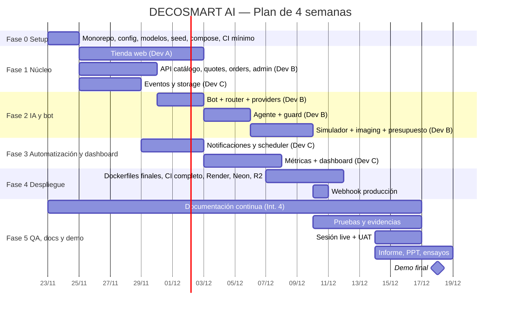

# 11 — Backlog, cronograma y organización del equipo

> Entregables 18 y 19. Orden técnico de implementación en [`CODEX_HANDOFF.md`](CODEX_HANDOFF.md) §7.
> Metodología: **Scrum ligero** — 4 sprints de 1 semana, planning el lunes, *daily* asíncrona (mensaje en el grupo), review + retro el viernes.

## 1. Equipo y roles

| Integrante | Rol | Área principal |
|---|---|---|
| **Dev A** | Frontend | Tienda web React (catálogo, carrito, cotización, checkout demo, Telegram button) |
| **Dev B** | Backend + bot + IA | Modelo de datos, API, bot de Telegram, agente IA, simulador, pipeline de imágenes, presupuesto |
| **Dev C** | Automatización + dashboard + DevOps | Eventos y notificaciones, scheduler, n8n opcional, dashboard Streamlit, Docker, CI/CD, Render/Neon/R2 |
| **Integrante 4** | Documentación, PPT y QA | Docs, informe técnico, presentación, plan de pruebas, set anti-alucinación, evidencias, guion de demo; *Scrum Master* |

Escala de estimación: puntos de historia (Fibonacci 1, 2, 3, 5, 8). Capacidad aproximada: 8–10 puntos por persona por semana.
Prioridad MoSCoW: **M** (Must), **S** (Should), **C** (Could), **W** (Won't, esta versión).

## 2. Backlog por fases

### Fase 0 — Setup (semana 1, días 1–2)

| ID | Historia de usuario | Prio | Pts | Resp. | Criterios de aceptación |
|---|---|---|---|---|---|
| F0-01 | Como equipo, quiero un monorepo con la estructura del handoff para trabajar en paralelo. | M | 2 | Dev C | Estructura §2 del handoff; `README.md`, `.env.example`, `.gitignore`; rama `main` protegida. |
| F0-02 | Como desarrollador, quiero `config.py`, `db.py`, modelos y migración Alembic inicial. | M | 5 | Dev B | `alembic upgrade head` crea las 16 tablas del doc 03 en Postgres y SQLite. |
| F0-03 | Como desarrollador, quiero un seed idempotente con 6 productos e imágenes. | M | 3 | Dev B | Ejecutar seed 2 veces deja 6 productos; datos idénticos a la tabla del doc 03. |
| F0-04 | Como desarrollador, quiero `/health` y `docker compose` con 4 servicios. | M | 3 | Dev C | TC-01 y TC-DEV-1 pasan. |
| F0-05 | Como equipo, quiero un CI mínimo que corra ruff, pytest y build. | M | 3 | Dev C | PR muestra checks verdes. |
| F0-06 | Como equipo, quiero el índice de docs y plantillas de informe. | M | 2 | Int. 4 | Docs 00–14 en `docs/`. |

### Fase 1 — Núcleo comercial (semana 1–2)

| ID | Historia de usuario | Prio | Pts | Resp. | Criterios de aceptación |
|---|---|---|---|---|---|
| F1-01 | Como cliente web, quiero ver el catálogo y filtrar por categoría. | M | 5 | Dev A | 6 productos con imagen, precio, stock; filtro funciona; TC-02/03. |
| F1-02 | Como cliente web, quiero ver el detalle con medidas, colores y stock. | M | 3 | Dev A | Badge "Últimas unidades" si `low_stock`; dimensiones ancho × alto × profundidad. |
| F1-03 | Como cliente web, quiero un carrito que persista. | M | 3 | Dev A | TC-13. |
| F1-04 | Como cliente web, quiero solicitar una cotización y ver su código. | M | 5 | Dev A + Dev B | `POST /api/quotes` → `/cotizacion/:code`; TC-07/08. |
| F1-05 | Como cliente web, quiero hacer un pedido demo sin pago. | M | 3 | Dev A + Dev B | TC-10, TC-15. |
| F1-06 | Como backend, quiero servicios de catálogo, cotizaciones, pedidos y códigos correlativos. | M | 8 | Dev B | Endpoints públicos de doc 04; precios congelados (TC-09); transiciones (TC-11). |
| F1-07 | Como admin, quiero endpoints `/admin/*` protegidos. | M | 5 | Dev B | TC-SEC-1; PATCH de estados y stock. |
| F1-08 | Como sistema, quiero registrar eventos de negocio. | M | 3 | Dev C | `emit()` inserta en `events`; handlers no propagan errores. |
| F1-09 | Como desarrollador, quiero storage local/S3 intercambiable. | M | 3 | Dev C | Tests de `put/get/url/delete` con local; prueba manual con R2. |
| F1-10 | Como cliente, quiero un sitio responsive y accesible. | S | 3 | Dev A | TC-14; `alt` en imágenes; foco visible. |

### Fase 2 — IA y bot (semana 2–3)

| ID | Historia de usuario | Prio | Pts | Resp. | Criterios de aceptación |
|---|---|---|---|---|---|
| F2-01 | Como cliente de Telegram, quiero un bot con menú y catálogo por botones. | M | 5 | Dev B | TC-17/18; 0 llamadas LLM. |
| F2-02 | Como sistema, quiero idempotencia, rate limit y manejo de errores en el bot. | M | 3 | Dev B | TC-19/20/21. |
| F2-03 | Como desarrollador, quiero `AIProvider` con `MockProvider` y `OpenAIProvider`. | M | 5 | Dev B | Cambiar `AI_MODE` no cambia el resto del código. |
| F2-04 | Como cliente, quiero preguntar en lenguaje natural por precios, medidas y stock. | M | 8 | Dev B | Bucle de tools; TC-22/24/25/26. |
| F2-05 | Como tienda, quiero que el agente nunca invente cifras. | M | 3 | Dev B | `guard.py`; TC-23; set §5 doc 09 20/20 en mock. |
| F2-06 | Como cliente, quiero recomendaciones según presupuesto, ambiente y ancho. | M | 3 | Dev B | Preguntas 7–9 del set. |
| F2-07 | Como cliente, quiero simular un mueble en una foto de mi ambiente. | M | 8 | Dev B | TC-27–30, TC-33/34. |
| F2-08 | Como tienda, quiero optimizar imágenes de entrada y salida. | M | 3 | Dev B | ≤ 1280 px sin EXIF; ≤ 768 px y ≤ 400 KB. |
| F2-09 | Como tienda, quiero cuotas y guardia de presupuesto. | M | 5 | Dev B | TC-31/32; `api_usage` en cada llamada. |
| F2-10 | Como cliente, quiero calificar la simulación con estrellas. | M | 2 | Dev B | TC-35. |
| F2-11 | Como cliente, quiero cotizar y pedir por Telegram. | M | 5 | Dev B | TC-36; flujo `order_contact`. |
| F2-12 | Como cliente web, quiero el deep link "Simular por Telegram". | S | 2 | Dev A + Dev B | TC-16. |
| F2-13 | Como cliente, quiero generar otra versión de la simulación. | C | 2 | Dev B | Requiere cuota y nueva confirmación; no usa caché. |

### Fase 3 — Automatización y dashboard (semana 2–3)

| ID | Historia de usuario | Prio | Pts | Resp. | Criterios de aceptación |
|---|---|---|---|---|---|
| F3-01 | Como admin, quiero recibir notificación de cada pedido demo. | M | 3 | Dev C | Notificación < 10 s; TC-10. |
| F3-02 | Como admin, quiero alertas de stock bajo. | M | 2 | Dev C | TC-12, una vez por producto hasta reponer. |
| F3-03 | Como cliente, quiero recibir la cotización y cambios de estado por Telegram. | M | 3 | Dev C | TC-36; `order.status_changed` notifica. |
| F3-04 | Como admin, quiero un resumen diario. | M | 3 | Dev C | TC-37; scheduler + endpoint. |
| F3-05 | Como sistema, quiero expirar cotizaciones y limpiar fotos automáticamente. | M | 3 | Dev C | Job horario/diario; TC-SEC-5. |
| F3-06 | Como admin, quiero aviso al 80 % del presupuesto. | M | 2 | Dev C + Dev B | TC-39. |
| F3-07 | Como admin, quiero endpoints de métricas para el dashboard. | M | 5 | Dev C | `/admin/metrics/*`, `/admin/usage` según doc 04. |
| F3-08 | Como admin, quiero un dashboard con KPIs del embudo y costos. | M | 8 | Dev C | Criterios doc 08 §5; TC-40. |
| F3-09 | Como tienda, quiero reenviar eventos a n8n. | C | 3 | Dev C | TC-38; workflow de ejemplo exportado. |

### Fase 4 — Despliegue (semana 3)

| ID | Historia de usuario | Prio | Pts | Resp. | Criterios de aceptación |
|---|---|---|---|---|---|
| F4-01 | Como equipo, quiero Dockerfiles finales para los 3 servicios. | M | 3 | Dev C | Build en CI; usuario no root. |
| F4-02 | Como equipo, quiero CI completo con job Postgres. | M | 3 | Dev C | TC-DEV-2 < 10 min. |
| F4-03 | Como equipo, quiero deploy automático a Render tras merge. | M | 3 | Dev C | TC-DEV-3. |
| F4-04 | Como equipo, quiero Neon y R2 configurados. | M | 3 | Dev C | `/health` `db: ok`; imágenes de productos desde R2. |
| F4-05 | Como cliente, quiero el bot de producción con webhook. | M | 2 | Dev B + Dev C | `getWebhookInfo` sin errores. |
| F4-06 | Como admin, quiero el resumen diario aunque Render duerma. | S | 1 | Dev C | `daily-summary.yml` ejecutado con éxito. |

### Fase 5 — QA, documentación y demo (semana 3–4)

| ID | Historia de usuario | Prio | Pts | Resp. | Criterios de aceptación |
|---|---|---|---|---|---|
| F5-01 | Como evaluador, quiero un plan de pruebas ejecutado con evidencias. | M | 5 | Int. 4 | Checklist doc 09 §8 completo. |
| F5-02 | Como evaluador, quiero ver el set anti-alucinación en live. | M | 3 | Int. 4 + Dev B | 20/20, costo registrado. |
| F5-03 | Como equipo, quiero UAT con usuarios externos. | S | 3 | Int. 4 | 5+ participantes, encuesta tabulada. |
| F5-04 | Como evaluador, quiero el informe técnico. | M | 8 | Int. 4 (+ todos) | Estructura doc 13; revisado por los 4. |
| F5-05 | Como evaluador, quiero la presentación (PPT) y la demo ≤ 5 min. | M | 5 | Int. 4 (+ todos) | Guion doc 14 ensayado 2 veces; video de respaldo. |
| F5-06 | Como evaluador, quiero la matriz de rúbrica con evidencias. | M | 2 | Int. 4 | Doc 12 con todas las casillas marcadas. |
| F5-07 | Como equipo, quiero conciliar costos con OpenAI. | M | 1 | Int. 4 + Dev B | Tabla doc 07 §7.3. |
| F5-08 | Como equipo, quiero corregir defectos encontrados en QA. | M | 5 | Todos | 0 defectos críticos abiertos. |

### Won't (esta versión)
Pagos reales, login de clientes, AR/VR, multi-idioma, CRUD admin web, embeddings, WhatsApp (ver [01 §6.3](01-proyecto-problema-objetivos.md)).

## 3. Cronograma (4 semanas)

Las fechas son referenciales (inicio lunes 2026-11-23); ajustar al calendario del curso manteniendo la secuencia.

| Semana | Objetivo del sprint | Entregable de la review |
|---|---|---|
| 1 | Esqueleto + núcleo comercial | Tienda con catálogo y cotización contra API local; compose levantado |
| 2 | Bot, agente en mock, automatización | Conversación en Telegram (mock) con precios reales; notificaciones admin |
| 3 | Simulador, dashboard, despliegue | Producción en Render; simulación mock y primera live; dashboard |
| 4 | QA, live controlado, docs, demo | Evidencias, informe, PPT, demo ensayada |

## 4. Reparto del trabajo (RACI)

R = Responsable (ejecuta), A = Aprobador (rinde cuentas), C = Consultado, I = Informado.

| Actividad / entregable | Dev A | Dev B | Dev C | Int. 4 |
|---|---|---|---|---|
| Tienda web React (`frontend/`) | **R/A** | C | I | C (QA) |
| Contratos de API (doc 04) | C | **R/A** | C | I |
| Modelo de datos y migraciones | I | **R/A** | C | I |
| Bot de Telegram | I | **R/A** | C | C (QA) |
| Agente IA, herramientas y prompts (doc 05) | I | **R/A** | I | C |
| Simulador e imágenes | I | **R/A** | C | C (QA) |
| Presupuesto y precios (doc 07) | I | **R** | C | **A** (conciliación) |
| Automatización y notificaciones | I | C | **R/A** | I |
| Dashboard Streamlit (doc 08) | C | C | **R/A** | C |
| Docker, CI/CD, Render, Neon, R2 (doc 10) | C | C | **R/A** | I |
| Seguridad y privacidad (doc 06) | C | **R** | **R** | **A** (checklist) |
| Plan de pruebas y ejecución (doc 09) | R (front) | R (back) | R (ops) | **A** |
| Documentación 00–14 | C | C | C | **R/A** |
| Informe técnico (doc 13) | R (sección front) | R (secciones IA/back) | R (secciones DevOps/automatización) | **A** (integración y redacción) |
| PPT y demo (doc 14) | R (tienda) | R (agente/simulación) | R (dashboard/DevOps) | **A** |

### Entregables concretos por integrante

| Integrante | Entregables |
|---|---|
| Dev A | `frontend/` completo, tests vitest, capturas de la tienda (desktop y 375 px), sección "Frontend" del informe. |
| Dev B | `backend/app` (excepto `automation/`), tests pytest del agente/bot/simulación, set anti-alucinación automatizado en mock, sección "Agente IA y simulación" del informe. |
| Dev C | `backend/app/automation/`, `services/metrics.py`, `dashboard/`, Dockerfiles, `docker-compose.yml`, `.github/workflows/*`, `render.yaml`, setup de Neon/R2/Render, sección "DevOps y automatización". |
| Integrante 4 | `docs/` 00–14, ejecución del plan de pruebas y evidencias, UAT, conciliación de costos, informe integrado, PPT, guion y video de respaldo de la demo. |

## 5. Flujo de trabajo Git

- **Ramas**: `main` (protegida, siempre desplegable) y ramas cortas `feat/<área>-<tema>` (p. ej. `feat/frontend-cart`, `feat/ai-bot-guard`), `fix/<tema>`, `docs/<tema>`, `chore/<tema>`. Ramas largas del handoff (`feat/backend-core`, `feat/frontend`, `feat/ops-dashboard`, `feat/ai-bot`) se integran por PRs frecuentes.
- **Pull Requests**: uno por historia o subtarea; descripción con ID de historia (p. ej. `F2-05`), cómo probar y capturas si hay UI; CI verde obligatorio; **1 revisión** de otro integrante (Dev B ↔ Dev C para backend; Int. 4 revisa docs y textos de UI/bot).
- **Merge**: *squash merge* para historial limpio; borrar la rama tras el merge.
- **Commits** (Conventional Commits, en español o inglés de forma consistente):
  - `feat(bot): agrega flujo de consentimiento de foto`
  - `fix(api): corrige total de cotización con varias unidades`
  - `test(agent): caso de guard con precio inventado`
  - `docs(devops): pasos de configuración de R2`
  - `chore(ci): cachea dependencias de npm`
  - `refactor(simulation): extrae cálculo de cache_key`
- **Issues**: cada historia como issue en GitHub con etiquetas `fase-0…5`, `MoSCoW`, área; tablero GitHub Projects (To do / In progress / Review / Done).
- **Versionado**: tag `v0.1.0` en la demo; `APP_VERSION` coincide con el tag.
- **Reglas de AGENTS.md**: tests con `AI_MODE=mock`, sin secretos en el código, cada cambio de backend con test.
